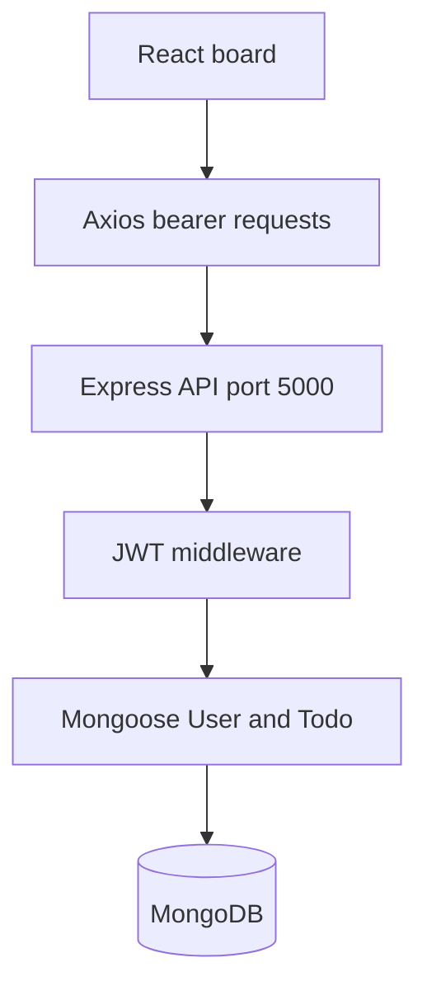

<a id="top"></a>

<div align="center">

# ✅ Task To-Do

**A React and Express task board with user accounts, subtasks, and ordering.**


[Repository](https://github.com/ashishgiije/Task-To-Do) · [Overview](#overview) · [Architecture](#architecture) · [Setup](#setup) · [Validation](#testing-and-validation) · [Audit](AUDIT_REPORT.md)

</div>

## Overview

A personal task organizer with separate pending and completed lists. Signed-in users create tasks with notes, subtasks, and recurrence labels, update progress, and reorder pending tasks. The backend scopes task reads and writes to the authenticated user.

## Visual preview

**Screenshot placeholder:** No verified application screenshot is supplied here. Capture the task board with sample tasks and subtasks. No image is fabricated.

## Key features

- Register, log in, retrieve current user, and log out locally.
- Create, update, delete, and reorder tasks.
- Notes, subtasks, completion timestamps, and recurrence metadata.
- Bearer-token authentication with hashed passwords.

## Technology stack

| Technology | Role in this checkout |
|---|---|
| React 19 + Vite 8 | Task board and client routing |
| Express 5 + Node.js | JSON API |
| MongoDB + Mongoose 9 | Users and task persistence |
| bcryptjs + JSON Web Tokens | Password hashing and bearer authentication |
| Axios | Client API calls |

## Architecture



## Application workflow

Register or log in → store token in the browser → create a task → check subtasks or mark it complete → drag pending tasks to reorder → persist through the API.

## Setup

```bash
git clone https://github.com/ashishgiije/Task-To-Do.git
cd Task-To-Do
```

Use Node.js 22.12+ or 24, npm, and a reachable MongoDB instance.

```bash
cd backend
npm ci
```

The backend already tracks a `.env` file; do not copy its values into documentation. Set `MONGO_URI`, `JWT_SECRET`, and optionally `PORT` securely for a disposable local database. Environment values take precedence over dotenv defaults. No migrations are required by Mongoose.

```bash
# From backend, with MONGO_URI and JWT_SECRET configured
npm run dev
# In another terminal, from the repository root
cd frontend
npm ci
npm run dev
```

API: `http://localhost:5000`; Vite normally uses `http://localhost:5173`. The frontend API base URL is hardcoded in `frontend/src/api.js`. Build the client with `cd frontend && npm run build`. No production deployment configuration is included.

## Project structure

```text
backend/server.js          # API startup
backend/routes/            # Authentication and task routes
backend/middleware/        # JWT verification
backend/models/            # User, Todo, embedded subtasks
frontend/src/pages/         # Login, registration, task board
frontend/src/api.js         # Axios API configuration
```

## API

| Method | Path | Authentication | Purpose |
|---|---|---|---|
| POST | `/api/auth/register` | Public | Create account |
| POST | `/api/auth/login` | Public | Issue token |
| GET | `/api/auth/me` | Bearer | Current user |
| GET / POST | `/api/todos` | Bearer | List or create tasks |
| PUT | `/api/todos/reorder/list` | Bearer | Save `orderedIds` |
| PUT / DELETE | `/api/todos/:id` | Bearer | Update or remove own task |

```bash
curl -X POST http://localhost:5000/api/todos \
  -H "Authorization: Bearer $TOKEN" -H 'Content-Type: application/json' \
  -d '{"title":"Review documentation","notes":"Check setup","recurrence":"none","subtasks":[]}'
```

A successful create returns HTTP 201 and the saved task document, including its generated `_id`, owner reference, and timestamps. `$TOKEN` means the token returned by login; do not paste real tokens into issues.

## Testing and validation

Current source review and checks (4 November 2026):

Frontend `npm ci` and `npm run build` passed. MongoDB-backed account/task workflows were not run because no usable database connection was supplied. The root `npm test` is a failing placeholder.

Use the setup commands above and the documented workflow for a local smoke check. No passing automated application suite is claimed where none exists.

## Limitations and roadmap

- Recurrence is stored as metadata; no scheduled regeneration service is present.
- The root `npm test` is a deliberate failing placeholder, not a test suite.
- Frontend builds do not demonstrate MongoDB-backed account and task behavior.
- Suggested roadmap: environment-based API URLs, authentication tests, and recurrence scheduling if desired.

<details>
<summary>Troubleshooting and contributions</summary>

Check the runtime versions and working directory first. For dependency installation failures, preserve TLS and checksum verification and inspect the first error. For external services, verify your local configuration and account permissions without sharing secret values.

Before contributing, read [the audit](AUDIT_REPORT.md), reproduce the affected behavior, and keep documentation changes separate from application fixes. Add tests for changed behavior and describe remaining limitations accurately.

</details>

## Author

**Ashish Gije** · [GitHub](https://github.com/ashishgiije)

[Back to top](#top)
